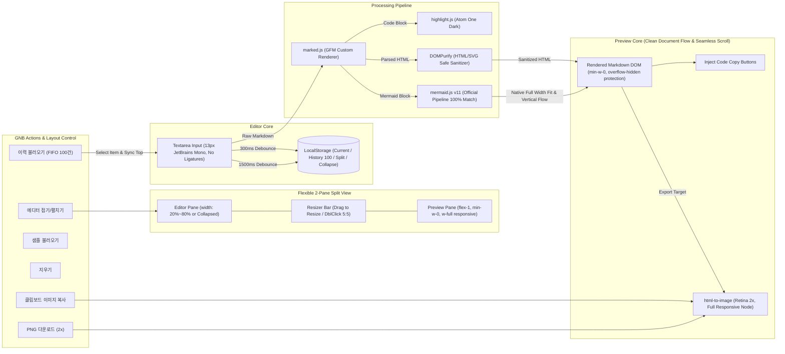

# Living Spec: Markdown Studio & Project Workspace Spec

## 1. 개요 및 목적
<<<<<<< Updated upstream
- **목적:** 천안·세종 2박 3일 가족 여행 일정 및 숙소 배정 현황을 안내하는 모바일 최적화 웹 가이드
- **대상:** 어르신(전영환 어르신 외), 성인, 어린이 포함 온 가족 9명 (야외/이동 중 모바일 시인성 극대화)
- **경로:** `trip/index.html`
- **구조:** 단일 HTML 파일 (Vanilla CSS + HTML5 + 순수 JS)

## 2. 디자인 시스템 (Warm Autumn Poster Theme & Senior-Friendly UI)
- **배경:** `#faf5ed` (포스터 특유의 포근한 크림 아이보리 톤으로 야외 눈부심 완화)
- **카드 표면:** `#ffffff` (따뜻한 베이지 보더 `#eddcc8` + 웜 브라운 소프트 그림자)
- **컬러 팔레트:** 단풍 테라코타 오렌지(`#ea580c`), 딥 브라운(`#9a3412`), 숲길 에메랄드(`#15803d`)
- **포스터 감성 반영:**
  - 헤더: "A Warm Autumn Getaway" 핸드라이팅 감성 영문 서브타이틀 및 리본 배너 스타일 적용
  - 원본 포스터 보기: 상단 유틸리티 바의 `[🎨 원본 포스터 보기]` 버튼 클릭 시 팝업 모달로 고화질 일러스트 확대 지원 (본문 영역 배너는 제거하여 화면 스크롤 압축)
  - 시간 캡슐 뱃지: 포스터와 동일한 어두운 브라운 캡슐(`background: #3c2415; color: #fffbeb`)로 일정 시간 직관적 노출
- **시니어 친화 UI/UX (60대 부모님 맞춤):**
  - **한국어 단어 단위 줄바꿈 (`word-break: keep-all` & `overflow-wrap: break-word`):** 조사나 어절 중간에 글자가 어색하게 끊기지 않고 단어 단위로 자연스럽게 개행되어 어르신들의 가독성 극대화
  - **전역 좌우 공간 확장 및 여백 최적화 (보통/큰글씨 공통):** 불필요한 바깥 여백을 줄이고 컨테이너 너비(`max-width: 540px`, padding: `12px 10px`), 타임라인 들여쓰기(`18px`), 카드 패딩(`13px 14px`)을 타이트하게 잡아 작은 글씨 및 큰 글씨 모두에서 문장이 불필요하게 줄바꿈되지 않고 시원하게 한눈에 들어오는 가독성 확보
  - **숙소 배정 아코디언 (기본 접힘):** 초기 접속 시 화면 스크롤을 줄여 1일 차 타임라인이 바로 눈에 들어오도록 평소에는 한 줄 요약(`🏨 숙소 배정 (소노벨 천안)`)으로 접혀있고, `[객실 자세히 보기 ▼]` 클릭 시 3가족 세부 호실 및 2일 차 방 이동 팁이 아래로 부드럽게 펼쳐짐
  - **✨ 주요 방문 식당 & 장소 안내 (확정 5곳 알림 아코디언):**
    1) 1일 차 점심: 달빛에구운고등어 천안구성점 (화덕 생선구이 모듬 및 셀프바)
    2) 1일 차 저녁: 알토 (청수동 나폴리 화덕피자·파스타 & 생일 파티 🎉)
    3) 2일 차 저녁: 사월에보리밥과 쭈꾸미 천안점 (직화 쭈꾸미 & 보리밥 정식)
    4) 3일 차 조식: 소노벨 천안 셰프스키친 (웨스트타워 1층 조식 뷔페)
    5) 3일 차 점심: 태조산시골막국수 (메밀막국수, 석갈비, 메밀전)
    - 상단 `[확정 5곳]` 뱃지와 함께 접이식 카드로 제공 (`[내용 보기 ▼]`로 열람)
  - **원클릭 길찾기 및 전화걸기:** 달빛에구운고등어, 아름다운정원 화수목, 소노벨 천안, 알토, 베어트리파크, 독립기념관, 사월에보리밥과쭈꾸미, 셰프스키친, 태조산시골막국수, 천안타운홀 등 주요 거점별 카카오맵 연동 버튼 및 전화 연결 제공
  - **열차 승차권 카드:** 코레일 티켓 모티브 UI 유지 (ITX-마음 1011호, 무궁화 1156호)
  - **SNS 공유 썸네일 (오픈그래프):** 카카오톡/문자 링크 공유 시 `poster.jpg`가 대표 썸네일 카드로 뜨도록 `og:image`, `twitter:image` 메타 태그 완비

## 3. 인터랙션 & UX
- **탭 전환 스크롤 복귀:** 일차 탭(1일 차/2일 차/3일 차) 변경 시 해당 일차 헤더 요약 박스로 부드럽게 스크롤 이동
- **포스터 원본 뷰어 모달:** 포스터 썸네일 클릭 시 전체화면으로 원본 확인 가능

## 4. 관련 가이드 및 문서 연동
- **종합 가이드:** `TRIP_GUIDE.md` (루트 디렉토리) - 전체 타임테이블, 숙소 연박/이동 가이드, 열차 정보 통합 관리
- **간이 일정표:** `trip/plan.md` - 마크다운 테이블 기반 빠른 조회용 일정표

## 5. Changelog
- **2026-10-08:**
  - 사용자가 전달한 최신 일정표에 맞춰 전체 일정 및 타임블록 전면 동기화:
    - 1일 차: 서울역 집결(10:00) ➔ 천안역 ➔ 점심: 달빛에구운고등어 천안구성점 ➔ 아름다운정원 화수목 산책&베이커리 ➔ 소노벨 체크인(휴식) ➔ 저녁: 알토(ALTO) 생일파티 ➔ 숙소 복귀
    - 2일 차: 브레드보드 조식 ➔ 베어트리파크 관람&점심(웰컴 레스토랑&카페) ➔ 숙소 복귀(새 객실 입실&휴식) ➔ 독립기념관 단풍나무숲길 산책 ➔ 저녁: 사월에보리밥과 쭈꾸미 천안점 ➔ 숙소 복귀
    - 3일 차: 소노벨 셰프스키친 조식뷔페 ➔ 체크아웃 ➔ 점심: 태조산시골막국수 ➔ 천안역 렌터카 반납 ➔ 천안타운홀 카페(47층) 담소 ➔ 기차 탑승 귀가
  - 신규 장소별 카카오맵 검색 링크 및 전화번호 다이렉트 버튼 탑재
  - `trip/index.html`, `trip/plan.md`, `TRIP_GUIDE.md` 3개 문서 완전 동기화 완료
- **2026-10-05:**
  - 1일 차: 소노벨 선체크인(휴식) 후 화수목 정원 산책 & 저녁/생일파티 코스로 변경
  - 2일 차: 오전~오후 베어트리파크(관람/점심/카페) -> 소노벨 새 객실 입실(휴식) -> 독립기념관 단풍나무숲길 -> 저녁 식사 코스로 변경
  - 3일 차: 체크아웃 후 렌트카 반납 -> 점심 식사 -> 천안타운홀 47층 전망대 카페 -> 기차 귀가 코스로 변경
  - 프로젝트 루트에 `TRIP_GUIDE.md` 통합 가이드 문서 신규 생성 및 동기화
=======
- **목적:** 번들러나 서버 없이 브라우저에서 즉시 실행되는 초경량 모던 다크 테마 실시간 마크다운 뷰어/에디터 (Mermaid 네이티브 다이어그램 통합)
- **경로:** `preview/index.html`
- **배포:** Vercel / Netlify / GitHub Pages 정적 호스팅 100% 호환 단일 HTML 구조

## 2. 디자인 시스템 (Linear / Notion Charcoal-Navy Dark Spec)
- **전체 배경:** `#1a1d24` (메인 셸)
- **패널 및 카드 표면:** `#1e212b` (미세 딥네이비 차콜)
- **보더 및 구분선:** `#2d313f` (1px 정돈된 라더)
- **리사이저 바:** 폭 6px hover/active 시 8px 블루 하이라이트 + 중앙 핀 도트
- **타이포그래피 및 코드 렌더링:**
  - 본문 텍스트: `#cfd3dc`, `0.875rem` (14px), line-height: `1.65`
  - 헤딩: H1 `1.45rem`, H2 `1.25rem`, H3 `1.05rem`, H4 `0.925rem`
  - **코드 리가처(합자) 원천 차단:** `font-variant-ligatures: none;`, `font-feature-settings: "liga" 0, "calt" 0;` 적용으로 `!==`, `===`, `=>` 등 연산자가 수학 기호로 뭉개지지 않고 작성 원문 그대로 1:1 보존
  - 인라인 코드: 배경 `#2a2e3d` + 텍스트 `#e5b967` (따뜻한 골드 옐로우) + `0.82em` (본문 대비 축소)
  - 코드 블록: 배경 `#16181f` + `0.775rem` (약 12.4px) + hover 'Copy Code' 버튼 포함
  - 불릿/번호 리스트: 좌측 들여쓰기 `1.4rem`, 아이템 간격 `0.4rem`
- **Mermaid 다이어그램 레이아웃:**
  - markdownlivepreview.com 공식 오픈소스(tanabe/markdown-live-preview)의 v11 파이프라인 100% 이식
  - `<pre class="mermaid">` 태그 + `mermaid.render(id, source, element)` + `bindFunctions(element)`

## 3. 핵심 기능 명세
1. **markdownlivepreview.com 공식 Mermaid v11 파이프라인 동기화:**
   - `mermaid@11` 최신 엔진 채택 (v10의 서브그래프 가로 찢김 버그 완전 해결)
   - 공식 CSS 스펙: `.mermaid { overflow-x: auto; padding: 12px 0; }` + `.mermaid svg { max-width: 100%; height: auto; }`
   - 프리뷰 컨테이너 이중 패딩 축소로 다이어그램의 가로폭 최대 활용
2. **에디터 접기/펼치기 토글 (Collapse / Expand):**
   - 상단 GNB 버튼으로 에디터를 완전히 숨기고 프리뷰 전용 전체 화면 모드로 즉시 전환
   - 상태 `localStorage` 영구 보존
3. **가변 너비 패널 리사이징 (Drag to Resize):**
   - 가운데 구분선 드래그로 20%~80% 비율 조절, 더블 클릭 5:5 복귀, 자동 저장
4. **실시간 파싱 & 고해상도 내보내기:**
   - `marked.js` + `highlight.js` + `DOMPurify` + `html-to-image` (2x Retina PNG 다운로드 및 클립보드 복사)

---

## Changelog
### [2026-10-29] 마크다운 이력 관리(FIFO 100건) 및 이력 불러오기 모달 구현
- **요약:** 로컬스토리지 기반으로 작성/열람한 마크다운을 최대 100건까지 FIFO 큐로 자동 누적 저장하고, 상단 '이력 불러오기' 버튼을 통해 첫 줄 제목 기반 리스트에서 선택 로드 및 최신순 동기화 기능 추가.
- **주요 변경:**
  - `md_studio_history_v1` LocalStorage 키 및 최대 100건 FIFO 제어 (101번째 진입 시 가장 오래된 마지막 항목 자동 삭제).
  - 첫 줄 기반 깔끔한 제목 추출(`extractMarkdownTitle`) 및 1.5초 디바운스 연속 작업 병합(파편화 방지).
  - 상단 GNB '이력 불러오기' 버튼 및 실시간 보존 건수 배지(`(n/100)`) 제공.
  - 이력 선택 시 에디터 로드, 실시간 프리뷰 렌더링, 최근 본 md(`md_studio_content_v1`) 및 히스토리 최상단 동기화 완료.

### [2026-10-29] Mermaid 블록 내 코드 복사 버튼 주입 격리 및 문법 파싱 오류 해결
- **요약:** `pre` 태그에 복사 버튼을 주입할 때 Mermaid 컨테이너(`<pre class="mermaid">`)까지 포함되어 다이어그램 코드 끝에 `Copy` 텍스트가 삽입되던 파싱 버그 해결.
- **주요 변경:**
  - `injectCodeCopyButtons`: `pre:not(.mermaid)` 셀렉터 적용 및 내부 `code` 요소 유무 가드 추가.

### [2026-10-29] markdownlivepreview.com 공식 GitHub 소스코드 직접 분석 및 100% 동일 구현 이식
- **요약:** https://markdownlivepreview.com/ 공식 GitHub 저장소(tanabe/markdown-live-preview)의 `package.json`, `main.js`, `style.css`를 직접 확인 및 분석하여 동일한 Mermaid v11 파이프라인으로 전환.
- **주요 변경:**
  - Mermaid 엔진 버전을 공식과 동일한 `mermaid@11` 최신판으로 업데이트 (v10 서브그래프 버그 해결).
  - 마크다운 파서 및 렌더링 호출을 공식과 동일하게 `<pre class="mermaid">${escapeHtml(code)}</pre>` 및 `mermaid.render(renderId, source, element)` + `bindFunctions(element)`로 전면 일치.
  - 프리뷰 컨테이너의 겹겹이 쌓인 여백을 최적화하여 다이어그램이 넓은 가로폭을 활용하도록 개선.
>>>>>>> Stashed changes
