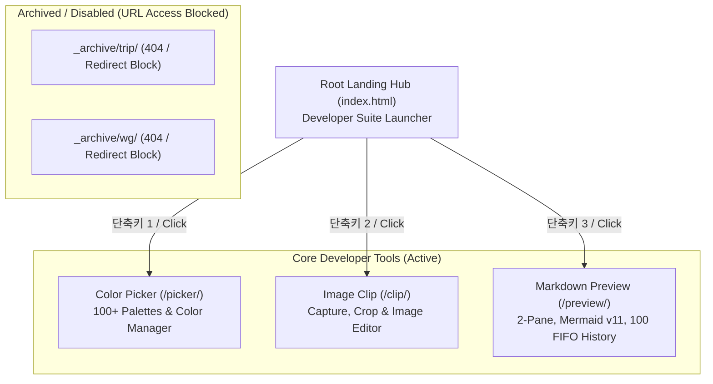

# Living Spec: Developer Workspace Suite & Utilities

---

## 1. 프로젝트 개요 & 통합 허브 구조
- **목적:** 번들러나 백엔드 서버 없이 브라우저에서 즉시 실행되는 경량 모던 웹 개발 유틸리티 스위트
- **배포:** Vercel, Netlify, GitHub Pages, 로컬 `file:///` 100% 호환 단일 정적 웹 구조
- **진입 경로:**
  1. `index.html` ➔ 통합 런처 대시보드 (Color Picker, Image Clip, Markdown Preview 3대 도구 안내 및 키보드 단축키 1~3 바로가기)
  2. `picker/index.html` ➔ 100개 이상의 체계적인 컬러 팔레트 관리자
  3. `clip/index.html` ➔ 웹 기반 이미지 크롭 & 클리핑 도구
  4. `preview/index.html` ➔ Linear/Notion 스타일 실시간 마크다운 & Mermaid v11 뷰어
  5. `_archive/` ➔ 비활성화된 기존 프로젝트(`trip`, `wg`)를 안전하게 격리 보관 (URL 직접 접근 시 리다이렉트 및 404 차단)

---

## 2. 디자인 시스템 (Linear / Notion Dark Theme)
- **전체 배경:** `#1a1d24` (메인 셸)
- **패널 및 카드 표면:** `#1e212b` (미세 딥네이비 차콜)
- **보더 및 구분선:** `#2d313f` (1px 정돈된 보더)
- **타이포그래피:** Pretendard (UI), JetBrains Mono (코드)

---

## 3. 핵심 도구별 명세

### ① Markdown Preview (`preview/index.html`)
- **2-Pane Split View:** 좌우 드래그 리사이저(20%~80%) 및 에디터 접기/펼치기 토글
- **공식 Mermaid v11 파이프라인:** markdownlivepreview.com 공식 스펙과 100% 일치하는 `<pre class="mermaid">` 및 비동기 렌더링
- **로컬 이력 관리:** 최대 100건 FIFO 큐, 첫 줄 제목 기반 모달 목록 로드 및 최신순 동기화
- **고해상도 캡처:** 2x Retina PNG 다운로드 및 클립보드 복사
- **코드 리가처 차단:** `!==`, `===` 등 프로그래밍 연산자 원본 1:1 보존

### ② Color Picker (`picker/index.html`)
- 100개 이상의 정돈된 디자인 시스템 컬러 팔레트 라이브러리
- HEX/RGB/HSL 색상 조회 및 원클릭 클립보드 복사

### ③ Image Clip (`clip/index.html`)
- 브라우저 기반 이미지 자르기, 영역 캡처 및 편집 최적화

---

## 4. Changelog
### [2026-10-29] 프로젝트 구조 전면 개편 (3대 도구 런처 허브 구축 및 trip/wg 아카이브)
- **요약:** 루트의 Color Manager를 `picker/`로 이동하고, 루트(`index.html`)를 3대 도구(Color Picker, Image Clip, Markdown Preview) 런처 대시보드로 신규 구축. 미사용 프로젝트(`trip`, `wg`)는 `_archive/`로 안전 격리하여 URL 접근 원천 차단.
- **주요 변경:**
  - `picker/index.html` 신규 생성 및 기존 색상 매니저 이전 (`/picker/` 경로).
  - 루트 `index.html`을 Linear 다크 테마 기반 3대 핵심 도구 런처로 신규 개발 (키보드 단축키 1, 2, 3 지원).
  - `trip/`, `wg/`를 `_archive/`로 이동 및 접속 시 즉시 루트 리다이렉트 가드 주입 (URL 접근 원천 봉쇄).

### [2026-10-29] 마크다운 이력 관리(FIFO 100건) 및 이력 불러오기 모달 구현
- **요약:** 로컬스토리지 기반으로 작성/열람한 마크다운을 최대 100건까지 FIFO 큐로 자동 누적 저장하고, 상단 '이력 불러오기' 버튼을 통해 첫 줄 제목 기반 리스트에서 선택 로드 및 최신순 동기화 기능 추가.
