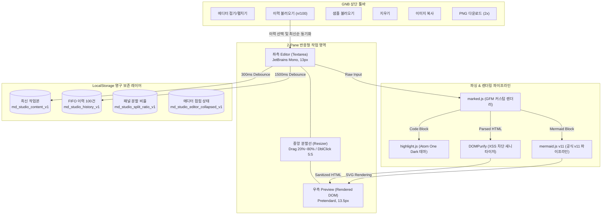

# Markdown Studio: 실시간 반응형 마크다운 뷰어 & 에디터 스펙

> **경로:** `preview/index.html`  
> **호스팅 환경:** 단일 정적 HTML 파일 (Vercel, Netlify, GitHub Pages, 로컬 `file:///` 호환)  
> **디자인 테마:** Linear / Notion Charcoal-Navy 다크 테마

---

## 1. 아키텍처 개요 (Architecture Flow)



---

## 2. 주요 기능 및 스펙 상세

### ① 2-Pane Split View & 반응형 레이아웃
- **데스크톱:** 좌측 에디터와 우측 프리뷰가 나란히 배치되는 2분할 구조.
- **가변 리사이징 (Drag to Resize):** 중앙 구분선을 드래그하여 에디터 너비를 20%~80% 범위 내에서 유연하게 조절 가능. 구분선 더블 클릭 시 즉시 5:5 비율로 초기화.
- **에디터 접기/펼치기 토글 (Collapsible Editor):** 상단 GNB의 토글 버튼 클릭 시 에디터 영역이 완전히 숨겨지고 우측 프리뷰가 100% 전체 폭을 활용하는 프리뷰 전용 모드로 전환.
- **모바일 지원:** 화면 폭이 좁은 모바일에서는 하단 탭(`EDITOR` / `PREVIEW`)을 통해 화면 전환 지원.
- **스크롤 동기화 (Scroll Sync):** 에디터와 프리뷰 간의 스크롤 위치를 비율 기반으로 실시간 상호 동기화.

### ② 마크다운 파싱 및 Mermaid v11 시각 차트 렌더링
- **마크다운 파서:** `marked.js` + `DOMPurify` 조합으로 GFM(GitHub Flavored Markdown), 줄바꿈 보존, XSS 원천 방어.
- **Mermaid v11 공식 파이프라인 일치:**
  - [markdownlivepreview.com](https://markdownlivepreview.com/) 공식 구현 방식과 100% 동일한 `<pre class="mermaid">${escapeHtml(code)}</pre>` 마크업 및 비동기 `mermaid.render(id, source, element)` 파이프라인 적용.
  - Mermaid 구버전(v10)의 서브그래프 가로 찢김 버그를 해결한 `mermaid@11` 최신 엔진 채택.
  - 다이어그램 코드 끝에 복사 버튼 문자열이 주입되어 파싱 에러가 발생하지 않도록 `pre:not(.mermaid)` 선택자 격리 가드 적용.

### ③ 로컬스토리지 기반 마크다운 이력 관리 (최대 100건 FIFO)
- **FIFO(선입선출) 큐:** 작성 또는 열람한 마크다운을 최대 100건까지 브라우저 로컬 저장소에 자동 누적하며, 101번째 저장 시 가장 오래된 0번째 항목을 자동 제거.
- **스마트 연속 편집 병합:** 타이핑할 때마다 불필요한 미완성 파편이 생성되지 않도록, 1.5초 디바운스를 적용하며 동일 제목의 3분 이내 연속 편집은 기존 최상단 항목을 갱신.
- **이력 불러오기 모달:**
  - 상단 GNB '이력 불러오기' 버튼 및 실시간 건수 배지(`(n/100)`) 제공.
  - 마크다운 첫 줄에서 특수문자를 정돈한 깔끔한 제목, 저장 시각, 글자 수 목록 표시.
  - 항목 선택 시 에디터에 로드되고 실시간 프리뷰 렌더링 및 해당 항목이 최상단(0번)으로 자동 재배치되어 "가장 최근에 본 문서"로 동기화.
  - 개별 항목 삭제 및 전체 비우기 지원.

### ④ 타이포그래피 & 코드 리가처 원천 차단
- **선명한 본문 계층:**
  - 본문 기본: `13.5px` (`#cfd3dc`, 줄높이 1.65)
  - H1: `1.45rem (~23.2px)`, H2: `1.15rem (~18.4px)`, H3: `0.985rem (~15.8px)`의 컴팩트한 계층 구조.
  - 인라인 코드: 따뜻한 골드 옐로우(`#e5b967`) 배경과 함께 본문 대비 살짝 작은 크기(`0.82em`)로 가독성 강화.
- **코드 리가처(합자) 억제:**
  - `font-variant-ligatures: none !important;` 및 `font-feature-settings: "liga" 0, "calt" 0 !important;` 적용.
  - 에디터 및 프리뷰 코드 블록에서 `!==`, `===`, `=>` 등 프로그래밍 연산자가 수학 기호(≢ 등)로 변형되지 않고 작성 원문 그대로 1:1 출력.

### ⑤ 고해상도 내보내기 & 클립보드 공유
- **2x Retina PNG 다운로드:** `html-to-image` 기반으로 고해상도(Retina 2배율) PNG 이미지 파일 생성 및 다운로드.
- **클립보드 이미지 복사:** `navigator.clipboard.write` API를 통해 화면을 클립보드에 이미지 데이터(PNG Blob) 형태로 직접 복사하여 Slack, Notion 등에 `Ctrl + V`로 즉시 공유 가능.
  > **보안 참고:** 웹 브라우저의 보안 정책상 클립보드 이미지 쓰기 API는 보안 컨텍스트(`http://localhost`, `https://`)에서만 허용되며, `file:///` 로컬 파일 환경에서는 보안상 제한될 수 있으므로 이 경우 [PNG 다운로드] 버튼을 권장.

---

## 3. 로컬스토리지 스키마 명세

| 키 이름 (Key) | 데이터 타입 | 설명 |
| :--- | :--- | :--- |
| `md_studio_content_v1` | `string` | 현재 에디터에서 작성 중인 최신 작업본 마크다운 텍스트 |
| `md_studio_history_v1` | `Array<HistoryItem>` | 최대 100건의 마크다운 이력 배열 (JSON 직렬화) |
| `md_studio_split_ratio_v1` | `string (float)` | 데스크톱 좌우 분할 비율 (기본값: 50.0%) |
| `md_studio_editor_collapsed_v1`| `string (boolean)` | 에디터 접힘 상태 (`"true"` / `"false"`) |

### `HistoryItem` 객체 구조
```typescript
interface HistoryItem {
  id: string;        // 'hist_' + timestamp (고유 식별자)
  title: string;     // 마크다운 첫 줄 기반 정제된 제목
  content: string;   // 전체 마크다운 원문
  length: number;    // 글자 수
  updatedAt: number; // 저장/수정 시각 타임스탬프 (ms)
}
```

---

## 4. 외부 의존 라이브러리 (CDN 기반, No Build)

모든 의존성은 번들러 없이 브라우저에서 직접 로드됩니다.

- **스타일링:** Tailwind CSS (`cdn.tailwindcss.com`)
- **웹폰트:** Pretendard (`orioncactus/pretendard`), JetBrains Mono (`Google Fonts`)
- **마크다운 파서:** `marked@12.0.2`
- **XSS 살균:** `DOMPurify@3.1.6`
- **구문 강조:** `highlight.js@11.9.0` (Atom One Dark 테마)
- **차트 렌더러:** `mermaid@11` (`mermaid@11.16.1` 호환 최신 배포본)
- **DOM 이미지 캡처:** `html-to-image@1.11.11`

