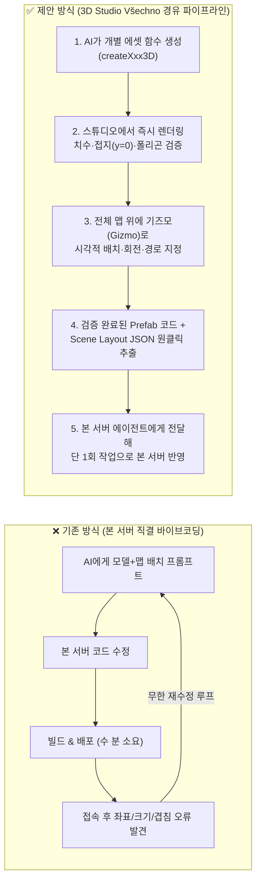
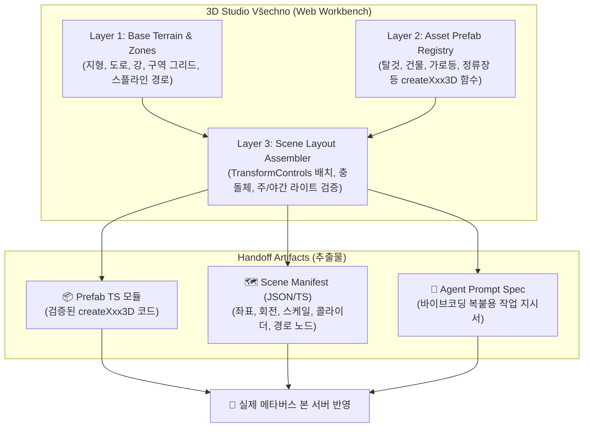

# 🏗️ 3D_STUDIO_VSECHNO: AI 바이브코딩 전용 3D 월드 & 에셋 어셈블러 기획서

> **핵심 요약 (TL;DR)**
> 개별 모델을 본 서버에 배포하기 전에 검증하려고 만든 `/3d/`(`3D Rig Showcase`)의 성공 공식을 **월드(Map) 단위**로 확장하는 아이디어는 **방향성이 매우 정확함.**
> 단, 웹에서 모든 메쉬를 깎는 '범용 3D 엔진(Blender/Unity)'을 재발명하려 하면 배보다 배꼽이 커지므로, **"AI가 짠 프로시저럴 에셋 코드(`Prefab`)를 가져와 눈으로 배치(`Layout`)하고, 에이전트에게 넘길 선언형 월드 데이터(`Scene Manifest`)와 규약 검증 결과를 추출하는 프리프로덕션 스튜디오"**로 역할을 날카롭게 정의해야 공수를 극적으로 줄일 수 있음.

---

## 1. 워크플로우 패러다임 전환 (Before vs After)

AI(LLM)는 코드는 잘 짜지만 **3차원 공간 감각(좌표, 회전축, 접지, 스케일 비례, 오브젝트 간 간섭)**이 없다. 기존의 비효율은 AI에게 "코드 생성"과 "공간 배치"를 동시에 시키고 이를 무거운 본 서버 배포로 확인했기 때문에 발생했다.



---

## 2. 비판적 검토 (Critical Review): 실패를 막는 3가지 안티테제와 해법

이 아이디어를 그대로 밀어붙일 때 반드시 부딪힐 **3가지 함정(안티테제)**과 이를 우회하는 실무적 해법이다.

### ⚠️ 안티테제 1: "Three.js 에디터 / 게임 엔진 바퀴의 재발명" 함정
- **위험:** 웹 툴 안에서 지형 조각, 정점(Vertex) 편집, 복잡한 물리 엔진까지 다 넣으려 하면 **메타버스 본체 개발보다 스튜디오 UI/상태 관리 코드 유지보수에 시간을 다 쓰게 됨.**
- **해법 (역할 제한):** 스튜디오는 '모델링 툴'이 아니라 **'코드 프리팹 검수기 + 월드 배치기(Assembler)'**로 선을 긋는다.
  - 형태 수정은 지금처럼 **코드(수치/루프) 수정 ➔ 즉시 리렌더**로 해결.
  - 스튜디오 뷰포트에서는 **이동(`W`) / 회전(`E`) / 스케일(`R`) 기즈모(`THREE.TransformControls`)**와 **지면/그리드 스냅**만 제공.

### ⚠️ 안티테제 2: "거대 단일 맵 코드 추출"의 역설 (AI 컨텍스트 폭발 & 환각)
- **위험:** 스튜디오에서 맵 전체와 수십 개 건물·탈것·소품을 구현한 뒤 **수만 줄짜리 통짜 코드 1개**로 뽑아서 AI 에이전트에게 넘기면, 에이전트가 토큰 한계에 걸리거나 수정 중 기존 좌표를 임의로 망가뜨림. 또한 본 서버에서 수정한 내용을 스튜디오로 다시 가져오는 **양방향 동기화(Round-trip)**가 불가능해짐.
- **해법 (`코드 Prefab`과 `배치 Manifest`의 철저한 분리):**
  - 스튜디오의 결과물은 '하나의 거대 코드'가 아니라 아래 **2가지의 분리된 산출물**이어야 함:
    1. **개별 에셋 팩토리 함수 (`prefabs/createPragueTram3D.ts`, `createOldTownTower3D.ts` 등):** 200~500줄 단위의 순수 Three.js 생성 함수.
    2. **월드 배치 매니페스트 (`world/vsechno-map.json` 또는 `sceneManifest.ts`):** 어떤 프리팹이 어느 좌표(`[x, y, z]`), 회전(`[rx, ry, rz]`), 스케일(`s`), 충돌 박스(`collider`)로 배치되는지 정의한 순수 데이터.
  - **효과:** AI 에이전트에게는 *"새 프리팹 파일 1개 추가하고, `sceneManifest.ts` 배열만 이 데이터로 교체해"*라고 지시하면 되므로 바이브코딩 실패율이 0%에 수렴함.

### ⚠️ 안티테제 3: Cloudflare 풀스택(D1 + DO + R2 + Zero Trust) 조기 구축의 YAGNI
- **위험:** 처음부터 DB 스키마 짜고 백엔드 API와 Durable Objects까지 붙이려다 정작 중요한 3D 맵 편집기 코어 개발이 늦어짐.
- **냉정한 기술 판단:**
  - **Durable Objects (DO):** 여러 명이 동시에 접속해 같은 맵에서 실시간 협동 편집(Figma처럼 커서 공유)할 때나 필요함. **나 혼자 쓰는 1인 스튜디오에서는 100% 불필요(오버엔지니어링)**하므로 과감히 제외!
  - **Pages + Zero Trust:** 내 작업실을 외부에 노출하지 않고 집/회사/모바일 어디서든 내 구글·깃허브 계정 하나로만 즉시 접속하게 해주는 **최고의 가성비 보안 레이어 (강력 추천).**
  - **D1 + R2:** 브라우저 `IndexedDB`만 쓰면 PC를 옮기거나 브라우저 캐시가 날아갈 때 작업물이 유실됨. 따라서 **D1(에셋 코드 카탈로그, 맵 버전 히스토리, 메타데이터)** + **R2(맵 스냅샷 썸네일, 대용량 씬 JSON 백업, 필요시 외부 텍스처/GLB)** 조합은 2단계에서 붙일 가치가 충분함.

---

## 3. 핵심 아키텍처 설계: 3-Layer 분리 구조

스튜디오와 실제 메타버스 본 서버가 **동일한 규약(Contract)**을 공유하도록 3개 레이어로 설계한다.



### 1) 에셋 규약의 확장: `CustomVehicleRig` ➔ `CustomWorldAssetRig`
현재 `/3d/`에서 탈것 규약(`+Z` 전방, `y=0` 지면, `wheels`, `frontSteerPivots`)이 대성공한 것처럼, **건물·소품·인프라 오브젝트도 표준 규약**을 정의하면 본 서버 이식이 자동화된다.

```typescript
export interface CustomWorldAssetRig {
  root: THREE.Group;                  // 필수: y=0 지면 접지, 중심축 정렬된 루트 그룹
  category: 'vehicle' | 'building' | 'prop' | 'foliage' | 'infrastructure';

  // 1) 물리/충돌 자동화 (스튜디오에서 바운딩 박스 시각화 및 자동 계산 지원)
  colliders?: Array<{
    type: 'box' | 'cylinder' | 'hull';
    offset: [number, number, number];
    size: [number, number, number];   // box: [w, h, d], cylinder: [radiusTop, radiusBottom, height]
  }>;

  // 2) 메타버스 낮/밤 사이클 연동 (야간에 켜질 창문, 가로등, 네온사인 재질)
  nightEmissiveMats?: THREE.MeshStandardMaterial[];

  // 3) 인터랙션 & 게임플레이 앵커 (문 입구, 트램 탑승 위치, 시트, 포털 등)
  anchors?: Array<{
    id: string;
    type: 'entrance' | 'seat' | 'spawn' | 'stop' | 'trigger';
    position: [number, number, number];
    rotationY?: number;
  }>;

  // 4) 탈것 전용 하위 호환 (기존 CustomVehicleRig 100% 호환)
  vehicleRig?: {
    wheels: THREE.Object3D[];
    frontSteerPivots?: THREE.Object3D[];
    headlightMat?: THREE.Material;
    taillightMat?: THREE.Material;
  };
}
```

### 2) 월드 배치 매니페스트 (`SceneManifest`) 구조
스튜디오에서 마우스로 오브젝트를 배치·수정한 뒤 최종 추출하는 데이터 포맷이다.

```json
{
  "mapId": "vsechno-prague-sector-01",
  "version": "1.2.0",
  "environment": {
    "groundSize": [1000, 1000],
    "defaultTimeOfDay": "day"
  },
  "splines": {
    "tram_line_22": {
      "closed": true,
      "points": [[0, 0, -120], [45, 0, -40], [45, 0, 60], [-30, 0, 90]]
    }
  },
  "instances": [
    {
      "uid": "bldg_powder_tower_01",
      "prefabId": "createPowderTower3D",
      "position": [120.5, 0, -45.0],
      "rotation": [0, 1.5708, 0],
      "scale": [1, 1, 1],
      "autoCollider": true,
      "tags": ["landmark", "old-town"]
    },
    {
      "uid": "prop_streetlamp_group_01",
      "prefabId": "createPragueLamp3D",
      "useInstancedMesh": true,
      "transforms": [
        { "pos": [10, 0, 10], "rotY": 0 },
        { "pos": [10, 0, 30], "rotY": 0 },
        { "pos": [10, 0, 50], "rotY": 0 }
      ]
    }
  ]
}
```
> 💡 **핵심 포인트 (`useInstancedMesh`):** 가로등, 나무, 벤치, 트램 침목처럼 맵에 수십~수백 개 반복 배치되는 오브젝트는 스튜디오에서 그룹으로 묶어두면 본 서버 코드 추출 시 자동으로 `THREE.InstancedMesh` 변환 플래그를 달아줄 수 있어 **메타버스 프레임 드랍(Draw Call 폭발)을 원천 예방**한다.

---

## 4. 스튜디오에 반드시 들어가야 할 핵심 기능 5가지

1. **듀얼 모드 전환 (`🔬 Asset Lab` ↔ `🗺️ World Map Studio`)**
   - **Asset Lab (현재 `/3d/` 모드):** 단일 모델 코드를 붙여넣고 바닥(`y=0`), 방향(`+Z`), 콜라이더 박스, 주/야간 점등, 시승 테스트를 정밀 검수한 뒤 **'내 프리팹 라이브러리에 등록'**.
   - **World Map Studio (신규 확장 모드):** 전체 맵 지형 위에서 라이브러리에 등록된 프리팹들을 꺼내 배치하고 전체 조감도·거리감·스카이라인을 확인.
2. **Three.js `TransformControls` 기즈모 & 스마트 스냅**
   - 마우스 클릭으로 오브젝트 선택 ➔ `W`(이동), `E`(회전), `R`(스케일) 조작.
   - `G` 키로 그리드 스냅(0.5m / 1m / 5m 단위) 및 `15°` 회전 스냅 지원.
   - `D` 키(Duplicate)로 가로등·건물 열 맞춰 빠른 복제 배치.
3. **스플라인 경로(Spline Path) 비주얼 에디터**
   - 프라하 트램(`createCzechTram3D`) 선로나 강물, 도로 중심선을 코드로 짜는 건 고통스러움.
   - 맵 바닥을 마우스로 콕콕 찍어 웨이포인트(Node)를 만들면 실시간으로 `CatmullRomCurve3` 곡선이 그려지고, 그 위에서 바로 트램을 굴려보며 회전 반경과 건물 간섭 여부를 검증.
4. **월드 퍼포먼스 & 콜라이더 엑스레이 HUD**
   - 맵 전체의 **총 삼각형(Triangles) 수, Draw Call 수, 오브젝트별 폴리곤 비중 Top 5**를 실시간 표시(과부하 모델 즉시 색출).
   - `Collider View` 토글 시 모든 건물·프롭의 충돌 박스를 반투명 와이어프레임으로 띄워, 플레이어나 차량이 끼이는 구간이 없는지 시승 모드로 전체 맵을 직접 주행하며 테스트.
5. **🤖 원클릭 AI 에이전트 핸드오프 익스포터 (Vibe-Coding Bridge)**
   - 스튜디오에서 수정한 내용만 감지(Diff)하여, 에이전트에게 바로 복붙할 수 있는 **Markdown 작업 지시서 + JSON/TS 코드 블록**을 클립보드로 복사.

---

## 5. 인프라 및 단계별 구축 로드맵 (Phased Rollout)

처음부터 무겁게 가지 않고, **당장 오늘부터 쓸 수 있는 단계**에서 출발해 점진적으로 확장한다.

| 단계 | 목표 | 저장소 & 인프라 | 핵심 구현 내용 |
| :--- | :--- | :--- | :--- |
| **Phase 1**<br/>*(즉시 가능 · 무서버)* | **로컬 월드 어셈블러 MVP** | 브라우저 `IndexedDB` +<br/>`.json`/`.ts` 파일 입출력 | 기존 `/3d/`에 **`World Studio` 탭** 추가, `TransformControls` 기즈모 연동, `IndexedDB`에 저장된 모델들을 한 씬에 멀티 스폰 & 배치, `SceneManifest` JSON Export/Import |
| **Phase 2**<br/>*(경로·물리·최적화)* | **트램 선로 & 월드 주행 검증** | Phase 1 동일 | 스플라인 경로 에디터(트램 주행선), 콜라이더 박스 자동 생성/시각화, 배치된 전체 월드 위에서 내 차량/트램으로 직접 돌아다니는 **월드 시승 모드** |
| **Phase 3**<br/>*(클라우드 작업실화)* | **개인 전용 클라우드 스튜디오** | **Cloudflare Pages + Zero Trust + D1 + R2** *(DO 제외)* | 별도 레포(또는 Pages Functions)로 분리, Zero Trust 이메일 인증 보호, **D1**에 프리팹 코드·맵 리비전 저장, **R2**에 맵 스냅샷·썸네일 백업 (어느 기기에서든 작업 이어하기) |

---

## 6. 결론 및 실행 제언

1. **아이디어 총평:**
   - AI 바이브코딩 시대에 3D 메타버스를 혼자(혹은 소수로) 빠르게 구축하려면 **"AI가 못하는 영역(시각적 공간 배치·비례 확인·경로 설계)은 인간이 웹 뷰포트에서 마우스로 10초 만에 끝내고, AI에게는 정제된 좌표 데이터와 모듈화된 함수만 넘긴다"**는 전략이 가장 확실한 치트키다.
2. **가장 먼저 할 일 (Next Step):**
   - Cloudflare D1/R2 세팅부터 시작하지 말고, **현재 `/3d/` 페이지의 `IndexedDB`에 저장된 여러 모델(사이버트럭, 트램, 부가티 + 앞으로 만들 건물들)을 하나의 넓은 그리드 맵에 동시에 불러와서 마우스 기즈모(`TransformControls`)로 배치하고 JSON 좌표를 뽑아보는 Phase 1 프로토타입**부터 붙여보는 것을 추천한다.
